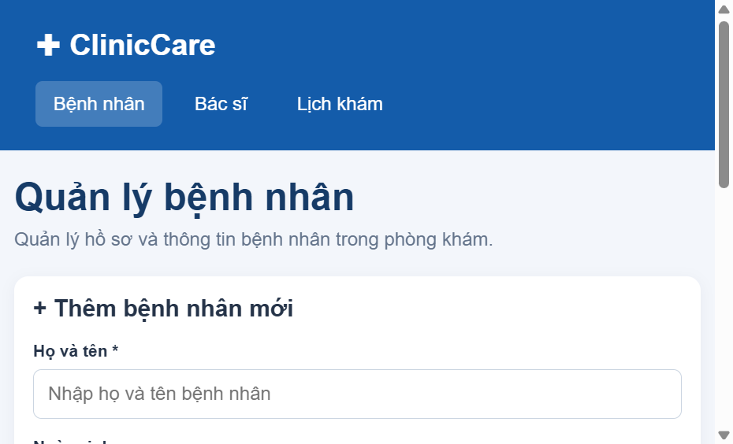
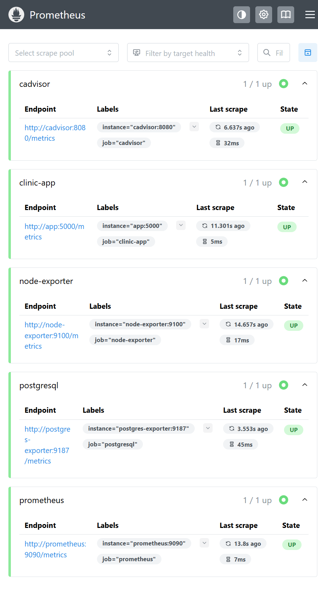
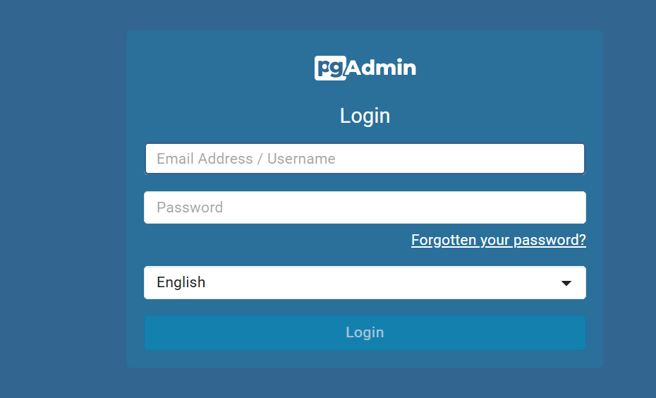
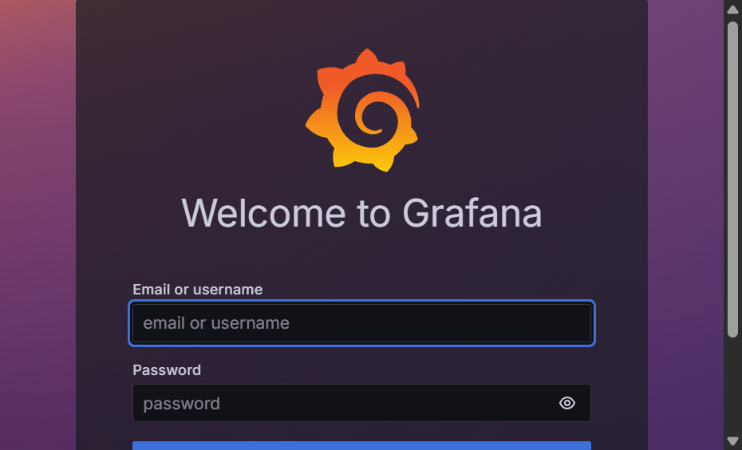

# BÁO CÁO TRIỂN KHAI VÀ QUẢN TRỊ HỆ THỐNG PHẦN MỀM

## Trang 1 — Bìa

<div align="center">

**TRƯỜNG / CƠ SỞ ĐÀO TẠO:** ........................................................
**KHOA / BỘ MÔN:** ........................................................................

<br><br><br>

# BÁO CÁO ĐỒ ÁN MÔN HỌC
## TRIỂN KHAI VÀ QUẢN TRỊ HỆ THỐNG PHẦN MỀM

<br>

### ĐỀ TÀI
# TRIỂN KHAI HỆ THỐNG QUẢN LÝ PHÒNG KHÁM CLINICCARE

<br><br>

</div>

| Thông tin sinh viên | Nội dung |
| --- | --- |
| Họ và tên | ................................................................ |
| Mã số sinh viên | ................................................................ |
| Lớp | ................................................................ |
| Giảng viên hướng dẫn | ................................................................ |
| Học kỳ / năm học | ................................................................ |

<div align="center">

**........................................, tháng 10 năm 2026**

</div>

> Bìa chưa có thông tin cá nhân; người làm báo cáo tự điền.

<div style="page-break-after: always;"></div>

## Trang 2 — Tóm tắt và mục tiêu

### 1. Tóm tắt

ClinicCare là ứng dụng web quản lý bệnh nhân, bác sĩ và lịch khám. Ứng dụng
được đóng gói cùng PostgreSQL và các dịch vụ quản trị, reverse proxy, metrics
và log tập trung bằng Docker Compose.

### 2. Mục tiêu

- Triển khai dịch vụ bằng container và phân tách kết nối theo vai trò.
- Duy trì dữ liệu PostgreSQL qua các lần recreate container.
- Cung cấp giao diện qua Nginx và giao diện quản trị qua pgAdmin.
- Thu thập metrics bằng Prometheus/exporters, trình bày bằng Grafana.
- Thu thập log bằng Promtail, lưu trữ trong Loki và tra cứu qua Grafana.
- Áp dụng hardening phù hợp và giữ bí mật ngoài mã nguồn.

### 3. Phạm vi bằng chứng

Chỉ ghi kết quả đã quan sát trực tiếp. Những nội dung chưa chạy hoặc chưa kiểm
chứng cần giữ nhãn **Chưa xác minh**, không thay bằng giả định.

<div style="page-break-after: always;"></div>

## Trang 3 — Kiến trúc tổng thể

```text
Trình duyệt
   │ localhost:8082
   ▼
Nginx ──► Flask/Gunicorn ──► PostgreSQL
                           ▲
pgAdmin ──────────────────┘

Flask, PostgreSQL, cAdvisor, Node Exporter
                    │
                    ▼
               Prometheus ──► Grafana

Docker logs ──► Promtail ──► Loki ──► Grafana
```

### Mạng

- `frontend`: Nginx và Flask.
- `backend`: Flask, PostgreSQL, pgAdmin, PostgreSQL Exporter và Prometheus.
- `monitoring`: Prometheus, Grafana, Loki, Promtail và các exporters.
- Các network frontend/backend/monitoring nội bộ được tách theo chức năng;
  `host_access` là bridge riêng cho UI/endpoint cần publish loopback.
- PostgreSQL không publish cổng host; giao diện công khai chỉ bind vào
  `127.0.0.1`.

### Điểm truy cập cấu hình

Website `http://localhost:8082`, pgAdmin `http://localhost:5050`,
Prometheus `http://localhost:9090`, Grafana `http://localhost:3000`, Loki
`http://localhost:3100/ready`.

<div style="page-break-after: always;"></div>

## Trang 4 — Cấu trúc và chức năng

| Thành phần | Chức năng |
| --- | --- |
| `app/app.py` | Flask routes, ORM models, health và metrics |
| `app/database.py` | Cấu hình SQLAlchemy |
| `app/templates/` | Giao diện bệnh nhân, bác sĩ, lịch khám và layout |
| `database/init.sql` | Khởi tạo bảng và dữ liệu bác sĩ ban đầu |
| `database/02-create-runtime-roles.sql` | Tạo app role CRUD và metrics role |
| `nginx/nginx.conf` | Reverse proxy và security headers |
| `docker-compose.yml` | Định nghĩa services, networks, healthchecks, volumes |
| `monitoring/prometheus.yml` | Scrape targets |
| `monitoring/alerts.yml` | Các cảnh báo Prometheus |
| `monitoring/loki-config.yml` | Lưu trữ và retention Loki |
| `monitoring/promtail-config.yml` | Phát hiện container, label và gửi log |
| `monitoring/grafana/` | Provision datasource và dashboard |
| `.env.example` | Mẫu biến môi trường không chứa secret thật |

Ứng dụng giữ các luồng nghiệp vụ hiện có: thêm/xem/xóa bệnh nhân và bác sĩ,
đặt lịch khám, đổi trạng thái lịch hẹn.

<div style="page-break-after: always;"></div>

## Trang 5 — Chuẩn bị và cấu hình

### Công cụ

- Windows với Docker Desktop và Linux containers.
- Docker Compose plugin.
- Trình duyệt web hiện đại.

### Biến môi trường

Tạo `.env` từ `.env.example`, sau đó điền mật khẩu PostgreSQL, pgAdmin,
Grafana và `FLASK_SECRET_KEY` đủ mạnh. `.env` bị loại khỏi Git.

Không đưa nội dung `.env` vào báo cáo hoặc ảnh chụp. Ghi nhận thay vì giá trị:

| Biến | Đã thiết lập? | Giá trị đưa vào báo cáo |
| --- | --- | --- |
| `POSTGRES_DB` / `POSTGRES_USER` | Có | Không công khai |
| `POSTGRES_PASSWORD` | Có | Che |
| `APP_DB_USER` / `APP_DB_PASSWORD` | Có | Che |
| `POSTGRES_EXPORTER_USER` / `POSTGRES_EXPORTER_PASSWORD` | Có | Che |
| `PGADMIN_DEFAULT_EMAIL` | Có | Che nếu cần |
| `PGADMIN_DEFAULT_PASSWORD` | Có | Che |
| `FLASK_SECRET_KEY` | Có | Không công khai |
| `GRAFANA_ADMIN_USER` | Có | Che nếu cần |
| `GRAFANA_ADMIN_PASSWORD` | Có | Che |

Không chụp `.env` thật. Mẫu placeholder an toàn nằm ở `.env.example`; cần tự
chụp màn hình file mẫu nếu giảng viên yêu cầu minh chứng biến môi trường.

<div style="page-break-after: always;"></div>

## Trang 6 — Quy trình triển khai

Các lệnh triển khai:

```powershell
docker compose config --quiet
docker compose up -d --build
docker compose ps
docker compose logs --tail 100
```

`docker compose config --quiet` dùng để kiểm tra cú pháp mà không in cấu hình
đã nội suy có thể chứa thông tin nhạy cảm. Không dùng
`docker compose down -v`; named volumes cần được giữ nguyên.

### Kết quả triển khai

- `docker compose config --quiet`: **hợp lệ**.
- `docker compose up -d --build`: **hoàn tất sau khi điều chỉnh network/mount**.
- Project/container prefix: `clinic-management`.
- Ngày xác minh: 18/10/2026.
- Named volumes hiện hữu được giữ; không xóa dữ liệu.

**Ảnh minh chứng 1 — Website:** Trang ClinicCare qua Nginx.



**Ảnh minh chứng 2 — Prometheus:** Trạng thái scrape targets.



**Giao diện quản trị:** Hai ảnh dưới đây chỉ xác nhận trang đăng nhập truy cập
được. Đăng nhập pgAdmin/Grafana chưa được xác minh trong phiên này.





<div style="page-break-after: always;"></div>

## Trang 7 — Website, reverse proxy và database

Nginx tiếp nhận HTTP tại cổng 8082 và proxy tới Flask trên network nội bộ.
Flask cung cấp `/health` để thử `SELECT 1` tới PostgreSQL; `/metrics` để
Prometheus scrape.

Kiểm tra:

```powershell
Invoke-WebRequest http://localhost:8082/health
docker compose logs --tail 100 app nginx db
```

Kết quả thực tế:

- `/health`: HTTP 200, JSON `status=ok`, `database=connected`.
- `/patients`, `/doctors`, `/appointments`: HTTP 200 (GET, không thay đổi dữ liệu).
- `X-Content-Type-Options`: `nosniff`.
- `X-Frame-Options`: `DENY`.
- `Referrer-Policy`: `strict-origin-when-cross-origin`.
- CSP: header đã nhận trên response Nginx.
- PostgreSQL healthcheck: healthy; app healthcheck: healthy.

Endpoint health và các trang nghiệp vụ đã được kiểm tra bằng HTTP; ảnh trên
chụp trang web trong trình duyệt. Không đưa dữ liệu liên hệ bệnh nhân vào ảnh.

<div style="page-break-after: always;"></div>

## Trang 8 — pgAdmin và quản trị PostgreSQL

pgAdmin được truy cập trên loopback cổng 5050. Đăng nhập bằng
`PGADMIN_DEFAULT_EMAIL` và `PGADMIN_DEFAULT_PASSWORD` từ `.env`. Tạo kết nối
server tới host `db`, port `5432`, database `POSTGRES_DB`, username
`APP_DB_USER` và password `APP_DB_PASSWORD` cho quyền CRUD ứng dụng.

Database không publish trực tiếp cổng 5432 ra host. pgAdmin và Flask truy cập
database thông qua network backend.

Kết quả thực tế:

- `http://localhost:5050/`: HTTP 200; trang đăng nhập pgAdmin hiển thị.
- `/misc/ping`: HTTP 200; healthcheck pgAdmin được cấu hình.
- Các biến đăng nhập pgAdmin tồn tại trong `.env`; không ghi giá trị bí mật.
- Đã xác thực tài khoản và đăng ký server DB: **Chưa thực hiện**.
- PostgreSQL healthcheck: healthy; cổng host 5432 không publish.

Ảnh minh chứng hiện có chỉ ghi nhận trang đăng nhập (không bao gồm thông tin
đăng nhập hoặc database đã kết nối):


<div style="page-break-after: always;"></div>

## Trang 9 — Prometheus, exporters và cảnh báo

Prometheus scrape các job:

- `prometheus`: trạng thái chính Prometheus.
- `clinic-app`: metrics của Flask.
- `postgresql`: metrics từ PostgreSQL Exporter.
- `cadvisor`: container metrics.
- `node-exporter`: metrics host Linux/Docker VM.

Mở `http://localhost:9090/targets`; mỗi target cần được kiểm tra trạng thái
thực tế. Quy tắc `HostCpuUsageHigh` đặt ngưỡng CPU trên 90% liên tục 3 phút.

| Job | Trạng thái thực tế |
| --- | --- |
| prometheus | UP |
| clinic-app | UP |
| postgresql | UP; `pg_up=1` |
| cadvisor | UP |
| node-exporter | UP; 64 series CPU, 1 series RAM |
| Alert rule được load | `HostCpuUsageHigh`, `ClinicAppUnavailable`, `PostgreSQLExporterUnavailable` |

Role exporter `clinic_metrics` không phải superuser và là thành viên
`pg_monitor`. Cảnh báo CPU định nghĩa ngưỡng >90% liên tục 3 phút; không tạo
tải cao chủ động nên trạng thái firing chưa kiểm tra.

Ảnh trang Prometheus Targets ở trên là kết quả chụp từ giao diện tại thời điểm
kiểm tra; API cũng xác nhận 5/5 targets `UP`.

<div style="page-break-after: always;"></div>

## Trang 10 — Grafana và dashboard

Grafana được provision với datasource Prometheus và Loki. Dashboard
**ClinicCare - Overview** có panel CPU/RAM host, CPU/RAM container, trạng thái
ứng dụng, hoạt động PostgreSQL và số request HTTP.

Kiểm tra URL `http://localhost:3000`, đăng nhập bằng
`GRAFANA_ADMIN_USER`/`GRAFANA_ADMIN_PASSWORD` trong `.env`, mở folder ClinicCare
và kiểm tra datasource/panel.

Kết quả thực tế:

- `http://localhost:3000/api/health`: HTTP 200.
- API xác thực bằng credential trong `.env` liệt kê datasources `Prometheus`,
  `Loki` và dashboard `ClinicCare - Overview`.
- Metrics API trả dữ liệu cho CPU/RAM, app và PostgreSQL.
- Dashboard được tìm thấy qua API; render/ảnh trực quan trong browser:
  **Chưa chụp minh chứng**.

Ảnh dưới đây chỉ xác nhận trang đăng nhập Grafana; không dùng làm bằng chứng
dashboard đã render. API Grafana xác nhận dashboard/provisioning tồn tại nhưng
ảnh dashboard sau đăng nhập **chưa được chụp**.


<div style="page-break-after: always;"></div>

## Trang 11 — Loki, Promtail và truy vấn log

Promtail phát hiện container bằng Docker service discovery và gắn label tên
container/service/project. Loki lưu log và Grafana Explore dùng datasource Loki.

Chạy từng truy vấn dưới đây trong Grafana Explore; điền `Đạt` chỉ khi giao diện
trả kết quả thành công:

```logql
{container="clinic-management-app-1"}
{container="clinic-management-nginx-1"} |= "error"
{container="clinic-management-db-1"} |~ "(?i)error"
```

| Truy vấn | Chạy thành công? | Container/label thực tế |
| --- | --- | --- |
| App | `status=success`, 1 stream | `clinic-management-app-1` |
| Nginx có `error` | `status=success`, 0 stream | Không có dòng khớp trong cửa sổ kiểm tra |
| DB có `error` | `status=success`, 0 stream | Không có dòng khớp trong cửa sổ kiểm tra |

Loki `/ready` trả HTTP 200 `ready`. Ba truy vấn chạy qua Loki API với
`status=success`. Hai truy vấn lọc error hợp lệ nhưng không tìm thấy dòng lỗi
trong khoảng thời gian truy vấn, đây không phải lỗi cú pháp.

Các truy vấn đã kiểm thử qua Loki HTTP API như bảng phía trên; ảnh Explore
trong Grafana chưa chụp vì chưa xác minh giao diện sau đăng nhập.

<div style="page-break-after: always;"></div>

## Trang 12 — Hardening, kết luận và nội dung còn thiếu

### Hardening

- Secret dùng `.env`, `.env` không được commit; `.env.example` chỉ là placeholder.
- Database và exporters không publish cổng host.
- App chạy non-root, filesystem read-only, `/tmp` tách bằng tmpfs, bỏ Linux
  capabilities và bật no-new-privileges.
- Tách các network frontend/backend/monitoring; chỉ publish cổng UI trên loopback.
- Các giao diện quản trị chỉ bind loopback.
- Nginx có security headers.
- Promtail cần quyền truy cập Docker socket; đây là quyền nhạy cảm và chỉ phù
  hợp trên máy tin cậy.
- Flask có role không-superuser chỉ CRUD; exporter có role riêng `pg_monitor`.
- Node Exporter/cAdvisor trong Docker Desktop phản ánh Linux VM. cAdvisor báo
  thiếu thông tin DMI `product_name` nhưng scrape target vẫn `UP`.
- Promtail đã hết vòng đời hỗ trợ upstream; cần cân nhắc Grafana Alloy cho hệ
  thống production.
- Promtail lúc đầu phát hiện ngoài project; đã thêm filter `clinic-management`.
  Loki có thể còn log cũ từ lần thử trong volume; không xóa dữ liệu, retention
  7 ngày sẽ xử lý theo cấu hình.
- Khi Compose thay container, Promtail ghi lỗi ngắn hạn do Docker target cũ đã
  bị xóa; các target mới được thêm sau đó. Lần xem log cuối không có log mới
  trong 90 giây. Các lỗi chuyển tiếp này được giữ lại như bằng chứng, không
  đánh đồng với lỗi truy vấn Loki.

### Quản lý mã nguồn

Repository local có ba commit theo yêu cầu đề bài:

1. `feat: deploy clinic app, PostgreSQL, pgAdmin and Nginx`
2. `feat: add Prometheus and Grafana monitoring`
3. `feat: add Loki log collection and harden services`

`.env` được ignore và không đưa vào commit. GitHub account, repository remote
và push chưa được thực hiện; chủ tài khoản cần tự tạo tài khoản với mã số sinh
viên nếu tên còn khả dụng, sau đó cấu hình remote.

### HTTPS

Chưa triển khai HTTPS tự ký. Tại thời điểm khảo sát, OpenSSL không có sẵn trên
host; không có chứng thư PEM đã xác minh. HTTP chỉ nên dùng cho máy phát triển
local. Muốn dùng HTTPS cần tạo chứng thư SAN cho hostname phù hợp, bảo vệ private
key, mount vào Nginx và kiểm tra chuỗi trust.

### Kết luận

Các endpoint website/pgAdmin/Prometheus/Grafana/Loki đã được kiểm tra trực
tiếp; 5 Prometheus targets đều `UP`; các truy vấn LogQL trả `status=success`.
Ảnh web và Prometheus đã chụp. Các việc chưa xác minh gồm đăng nhập pgAdmin
và kết nối server bằng browser, render trực quan dashboard, firing của cảnh
báo CPU và HTTPS. Git local có đủ ba commit nhưng yêu cầu tài khoản/repository
GitHub chưa hoàn tất.

**Ngày xác minh:** 18/10/2026
**Ảnh chụp:** `evidence/`; ảnh giao diện chưa đăng nhập không được coi là bằng
chứng đã kết nối database/dashboard.
