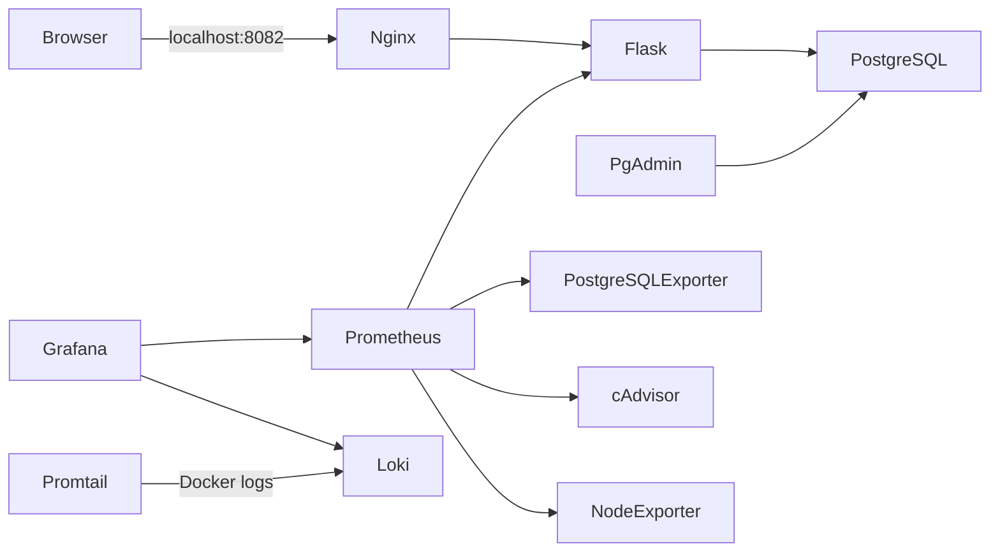

# ClinicCare — Quản lý phòng khám

Ứng dụng quản lý bệnh nhân, bác sĩ và lịch khám được triển khai bằng Flask,
PostgreSQL, Docker Compose và Nginx. Bộ giám sát gồm Prometheus, Grafana,
Loki, Promtail, cAdvisor, Node Exporter và PostgreSQL Exporter.

## Truy cập nhanh và tài khoản dịch vụ

| Dịch vụ | Địa chỉ | Tài khoản | Mật khẩu |
| --- | --- | --- | --- |
| Website ClinicCare | <http://localhost:8082> | Không yêu cầu đăng nhập | Không áp dụng |
| pgAdmin | <http://localhost:5050> | Giá trị `PGADMIN_DEFAULT_EMAIL` trong `.env` | Giá trị `PGADMIN_DEFAULT_PASSWORD` trong `.env` |
| Grafana | <http://localhost:3000> | `admin` | Giá trị `GRAFANA_ADMIN_PASSWORD` trong `.env` |
| Prometheus | <http://localhost:9090> | Không yêu cầu đăng nhập | Không áp dụng |
| PostgreSQL (đăng ký trong pgAdmin) | Host `db`, port `5432` | `clinic_runtime` (database `clinicdb`) | Giá trị `APP_DB_PASSWORD` trong `.env` |

Thông tin đăng nhập pgAdmin và PostgreSQL là hai bộ thông tin riêng. pgAdmin
dùng `PGADMIN_DEFAULT_EMAIL`/`PGADMIN_DEFAULT_PASSWORD` để đăng nhập giao diện;
kết nối database dùng `APP_DB_USER`/`APP_DB_PASSWORD`. Không ghi mật khẩu thật
vào README, ảnh chụp hoặc Git.

Để kiểm tra hoặc cập nhật thông tin đăng nhập trên máy này, mở `.env`. Nếu
muốn xem các biến mật khẩu còn lại trong PowerShell, chạy lệnh sau từ thư mục
dự án; đừng chụp/chia sẻ đầu ra:

```powershell
$keys = 'PGADMIN_DEFAULT_EMAIL','PGADMIN_DEFAULT_PASSWORD','GRAFANA_ADMIN_USER','GRAFANA_ADMIN_PASSWORD','APP_DB_USER','APP_DB_PASSWORD','POSTGRES_DB'
Get-Content .env | ForEach-Object {
    if ($_ -match '^([^#=]+)=(.*)$' -and $keys -contains $matches[1]) {
        if ($matches[1] -like '*PASSWORD') { '{0}=<đã cấu hình>' -f $matches[1] }
        else { '{0}={1}' -f $matches[1], $matches[2] }
    }
}
```

Không gửi hoặc chụp lại đầu ra có mật khẩu; website truy cập được sau khi stack
đã khởi động bằng `docker compose up -d`.

> Mật khẩu và khóa bí mật chỉ được lưu trong `.env` tại máy chạy dự án.
> Không đưa `.env` vào Git, ảnh chụp báo cáo hoặc nội dung gửi công khai.

## Kiến trúc



- `frontend` nối Nginx với Flask; `backend` nối Flask, PostgreSQL, pgAdmin,
  PostgreSQL Exporter và Prometheus. PostgreSQL không publish cổng ra host.
- `monitoring` nối Prometheus, Grafana, Loki, Promtail và exporters.
- `host_access` là network bridge cho các giao diện cần publish; các cổng chỉ
  bind vào `127.0.0.1`. Network này cho phép outbound qua Docker bridge.
- PostgreSQL, pgAdmin, Prometheus, Grafana và Loki dùng named volumes để giữ
  dữ liệu khi container được thay mới. Không dùng `docker compose down -v`.
- Flask chạy bằng Gunicorn với user không đặc quyền. Nginx thêm các security
  headers cho website.

## Cây thư mục

```text
clinic-management/
├── .env.example
├── .gitattributes
├── .gitignore
├── docker-compose.yml
├── README.md
├── app/
│   ├── app.py
│   ├── database.py
│   ├── Dockerfile
│   ├── requirements.txt
│   ├── static/
│   │   ├── cliniccare.css
│   │   ├── cliniccare.js
│   │   └── confirm-delete.js
│   └── templates/
│       ├── appointments.html
│       ├── base.html
│       ├── dashboard.html
│       ├── doctors.html
│       └── patients.html
├── database/
│   ├── init.sql
│   └── 02-create-runtime-roles.sql
├── evidence/
│   ├── 02-prometheus-targets.png
│   ├── 03-pgadmin-login.png
│   ├── 04-grafana-login.png
│   ├── 05-grafana-home.png
│   ├── 06-cliniccare-dashboard.png
│   ├── 07-pgadmin-authenticated.png
│   ├── 08-loki-explore.png
│   ├── 09-loki-explore-results.png
│   └── 10-cliniccare-dashboard-current.png
├── nginx/
│   └── nginx.conf
└── monitoring/
    ├── alerts.yml
    ├── loki-config.yml
    ├── prometheus.yml
    ├── promtail-config.yml
    └── grafana/
        ├── dashboards/clinic-management.json
        └── provisioning/
            ├── dashboards/dashboards.yml
            └── datasources/datasources.yml
```

## Giao diện ClinicCare

- **Tổng quan** (`/dashboard`): tổng số bệnh nhân, bác sĩ, lịch khám, lịch
  trong ngày; biểu đồ 7 ngày và thống kê trạng thái được truy vấn từ
  PostgreSQL.
- **Bệnh nhân** (`/patients`) và **Bác sĩ** (`/doctors`): thêm, tìm kiếm,
  phân trang, sửa trong hộp thoại và xóa có xác nhận; dữ liệu vẫn dùng các
  bảng hiện có.
- **Lịch khám** (`/appointments`): tạo lịch, xem/sửa chi tiết, tìm kiếm,
  phân trang và cập nhật trạng thái.
- Bố cục co giãn trên desktop/điện thoại; stylesheet và JavaScript được phục
  vụ từ `app/static/`, không thêm thư viện frontend hoặc thay framework Flask.

## Dịch vụ và địa chỉ

| Dịch vụ | Địa chỉ từ máy chủ | Vai trò |
| --- | --- | --- |
| ClinicCare qua Nginx | <http://localhost:8082> | Website bệnh nhân, bác sĩ, lịch khám |
| pgAdmin | <http://localhost:5050> | Giao diện quản trị PostgreSQL |
| Prometheus | <http://localhost:9090> | Metrics, scrape targets và cảnh báo |
| Grafana | <http://localhost:3000> | Dashboard và truy vấn metrics/logs |
| Loki API | <http://localhost:3100/ready> | API lưu trữ log |
| Flask trực tiếp | Không publish | Chỉ truy cập nội bộ qua Nginx/Prometheus |
| PostgreSQL | Không publish | Chỉ truy cập qua network `backend` |
| Exporters | Không publish | Chỉ Prometheus truy cập trên network nội bộ |

Các cổng host chỉ bind vào loopback (`127.0.0.1`), không chủ ý mở ra mạng LAN.

### Thông tin đăng nhập

- pgAdmin: dùng `PGADMIN_DEFAULT_EMAIL` và `PGADMIN_DEFAULT_PASSWORD` trong
  `.env`. Khi đăng ký máy chủ PostgreSQL trong pgAdmin, nhập host `db`, port
  `5432`, database `POSTGRES_DB`. Tài khoản `APP_DB_USER` có quyền CRUD trong
  schema `public`; `POSTGRES_USER` có quyền quản trị cao hơn. Dùng app role cho
  kết nối xem dữ liệu thông thường. Mật khẩu pgAdmin không phải mật khẩu
  PostgreSQL.
- Grafana: dùng `GRAFANA_ADMIN_USER` và `GRAFANA_ADMIN_PASSWORD` trong `.env`.
- Không ghi lại giá trị mật khẩu trong báo cáo. Nếu cần ảnh đăng nhập, che các
  trường thông tin xác thực.

### Đăng ký PostgreSQL server trong pgAdmin

Sau khi đăng nhập tại <http://localhost:5050>, chọn **Add New Server**.
Trong tab **General**, đặt tên dễ nhận biết, ví dụ `ClinicCare PostgreSQL`.
Trong tab **Connection**, nhập:

| Trường pgAdmin | Giá trị |
| --- | --- |
| Host name/address | `db` |
| Port | `5432` |
| Maintenance database | Giá trị `POSTGRES_DB` trong `.env` |
| Username | Giá trị `APP_DB_USER` trong `.env` |
| Password | Giá trị `APP_DB_PASSWORD` trong `.env` |

Nếu server đã được đăng ký, mở **Properties → Connection** để sửa các trường
trên; không tạo thêm server trùng tên. Khi hộp thoại kết nối yêu cầu mật khẩu,
nhập giá trị `APP_DB_PASSWORD` trong `.env` và chọn **Save Password** chỉ khi
muốn lưu credential trong hồ sơ pgAdmin cục bộ. Chỉ đọc các giá trị từ `.env`
cục bộ; không ghi chúng vào terminal dùng chung, ảnh chụp hoặc Git. Không cần
publish cổng PostgreSQL ra host vì pgAdmin kết nối qua Docker network.

## Cài đặt và khởi động

1. Cài Docker Desktop và bật Linux containers.
2. Tạo `.env` từ mẫu (nếu chưa có):

   ```powershell
   Copy-Item .env.example .env
   ```

3. Thay các giá trị mẫu trong `.env` bằng email hợp lệ và mật khẩu/secret ngẫu
   nhiên mạnh. Giữ nguyên `.env` cục bộ; không commit file này.
4. Kiểm tra cấu hình và khởi động:

   ```powershell
   docker compose config --quiet
   docker compose up -d --build
   docker compose ps
   ```

5. Chờ healthcheck của PostgreSQL và ứng dụng chuyển sang `healthy`, sau đó
   truy cập các địa chỉ trong bảng trên.

Tạo `FLASK_SECRET_KEY` ngẫu nhiên mạnh cho môi trường thực tế; không chia sẻ
giá trị đó hoặc đưa `.env` vào Git. Ứng dụng mặc định chạy HTTP local với
`SESSION_COOKIE_SECURE=false`; đặt biến này thành `true` trong `.env` khi chạy
qua HTTPS để chỉ gửi cookie qua kết nối bảo mật.

Compose sẽ tạo/recreate các container khi cấu hình thay đổi; named volumes
không bị xóa bởi `up -d --build`. File `database/init.sql` chỉ được PostgreSQL
chạy khi khởi tạo data directory lần đầu, không phải cơ chế migration cho
database đã tồn tại. Ứng dụng sử dụng role `APP_DB_USER` có quyền CRUD, còn
PostgreSQL Exporter dùng role riêng chỉ được cấp `pg_monitor`. Khi database
đã tồn tại, cập nhật role cần được áp dụng tường minh bằng
`database/02-create-runtime-roles.sql`; không xóa volume.

## Xác minh

### Website, database và headers

```powershell
Invoke-WebRequest http://localhost:8082/health
Invoke-WebRequest -Method Head http://localhost:8082/
docker compose ps
docker compose logs --tail 100 app db nginx pgadmin
```

`/health` trả HTTP 200 khi Flask truy vấn được PostgreSQL; lỗi kết nối trả
HTTP 503. Nginx cần trả các header `X-Content-Type-Options`,
`X-Frame-Options` và `Referrer-Policy`.

### Prometheus

Mở <http://localhost:9090/targets> và kiểm tra các job `prometheus`,
`clinic-app`, `postgresql`, `cadvisor` và `node-exporter` có trạng thái `UP`.
Có thể kiểm tra API:

```powershell
Invoke-RestMethod http://localhost:9090/api/v1/targets
Invoke-WebRequest http://localhost:9090/-/healthy
```

### Grafana

Datasource Prometheus và Loki được provision tự động. Dashboard **ClinicCare -
Overview** được provision trong folder **ClinicCare**. CPU/RAM host, app,
PostgreSQL và HTTP metrics có thể hiển thị. Trên Docker Desktop/Windows,
cAdvisor hiện chỉ cung cấp cgroup tổng hợp của Linux VM (không có nhãn từng
container); dashboard dùng tên panel **Docker VM cgroups** để phản ánh đúng
phạm vi đo. Nếu dashboard trống, kiểm tra targets, thời gian thu thập và log.

### Loki và LogQL

Promtail phát hiện container qua Docker socket; label `container` là tên
container đầy đủ từ Docker (ví dụ `clinic-management-db-1`), `service` và
`service_name` cùng lấy từ Docker Compose service label (ví dụ `db`), còn
`project` là `clinic-management`. Chọn datasource Loki trong Grafana Explore.
Để lọc database logs và tìm `error` không phân biệt hoa/thường, chạy:

```logql
{service_name="db"} |~ "(?i)error"
```

Tương đương theo tên container thực tế:

```logql
{container="clinic-management-db-1"} |~ "(?i)error"
```

`|~` áp dụng regex case-insensitive `(?i)` lên nội dung log. Promtail được
giới hạn vào Compose project `clinic-management`, không đọc log của project
khác. Truy vấn không có kết quả trong time range chỉ có nghĩa là không tìm
thấy dòng khớp, không phải lỗi truy vấn.

```powershell
docker compose exec promtail /usr/bin/promtail --check-syntax --config.file=/etc/promtail/promtail-config.yml
docker compose config --quiet
docker compose restart promtail
docker compose ps promtail loki
Invoke-WebRequest http://localhost:3100/ready
Invoke-RestMethod http://localhost:3100/loki/api/v1/labels
docker compose logs --tail 100 loki promtail
```

Sau khi thêm label `service_name`, các lệnh trên đã được chạy; Promtail/Loki
đang hoạt động. Loki trả `ready`, truy vấn `{service_name="db"}` trả
`status=success` với 1 stream trong 24 giờ, còn hai truy vấn `error` ở trên
trả `status=success` nhưng 0 stream khớp trong 24 giờ. Truy vấn app
`{service_name="app"}` trả 1 stream sau một request kiểm tra HTTP. Không có
dòng lỗi DB nào được tạo giả để làm cho query trả kết quả.

### Tình trạng bằng chứng đã chạy

| Kiểm tra | Kết quả thực tế |
| --- | --- |
| Compose config cuối cùng | `docker compose config --quiet`: hợp lệ |
| Stack | `docker compose up -d --build`: hoàn tất |
| Website `/health`, `/patients`, `/doctors`, `/appointments` | HTTP 200; health báo database connected |
| Patient CRUD browser check | Tạo và đọc lại duy nhất bản ghi thử `VALIDATION-*`; hủy hộp thoại xác nhận giữ bản ghi; xác nhận xóa chỉ xóa bản ghi thử; truy vấn đếm sau cùng xác nhận không còn bản ghi `VALIDATION-*`; bản ghi bệnh nhân có trước vẫn còn |
| pgAdmin và PostgreSQL | pgAdmin `/misc/ping`: HTTP 200; server `ClinicCare PostgreSQL` dùng host `db`, database `clinicdb`, role `clinic_runtime`; đăng nhập PostgreSQL từ network/container pgAdmin bằng `APP_DB_PASSWORD` thành công. Giao diện pgAdmin vẫn cần nhập mật khẩu khi mở kết nối; ảnh cũ chưa chứng minh session database trong UI. |
| Prometheus | `/-/healthy`: HTTP 200; API kiểm tra 5/5 targets `UP` |
| PostgreSQL exporter | `pg_up=1`; app/exporter role không phải superuser, exporter có `pg_monitor` |
| Node Exporter | Target `UP`; 64 series CPU và 1 series RAM |
| Grafana | `/api/health`: HTTP 200; datasource Loki/Prometheus có health `OK`; dashboard UID `clinic-care-overview` tìm thấy qua API |
| Grafana dashboard | Sau reload provisioning, browser hiển thị đủ 7 panel; host, app, PostgreSQL, HTTP và cgroup panels có dữ liệu. cAdvisor trả cgroup tổng hợp Docker VM, không phải từng container |
| Grafana Explore | Đã mở datasource Loki, query selector app và xem được kết quả log; khi reload, plugin `grafana-lokiexplore-app` v1.0.39 trả lỗi preload do `react/jsx-runtime` HTTP 404 từ module plugin; chưa sửa |
| Loki | `/ready`: HTTP 200 (`ready`); lần kiểm tra lặp lại sau một phản hồi 503 ban đầu trả 200, API labels hoạt động |
| `{container="clinic-management-app-1"}` | Loki API `status=success`, 1 stream trong cửa sổ kiểm tra |
| `{container="clinic-management-nginx-1"} |= "error"` | Loki API `status=success`, 0 stream trong cửa sổ kiểm tra |
| `{container="clinic-management-db-1"} \|~ "(?i)error"` | Loki API `status=success`, 0 stream trong cửa sổ kiểm tra |
| Loki Explore screenshots | Query app và kết quả logs đã chụp trong `evidence/08-loki-explore.png` và `evidence/09-loki-explore-results.png` |
| Nginx headers | `nosniff`, `DENY`, `strict-origin-when-cross-origin` và CSP đã nhận |
| CSP delete confirmation | Static script cùng nguồn hoạt động; trình duyệt hiện hộp xác nhận, dismiss giữ nguyên bản ghi; script được tải HTTP 200 |
| HTTPS | Chưa cấu hình; môi trường hiện không có OpenSSL để tạo cert PEM cục bộ |

## Log, xử lý sự cố và dừng dịch vụ

```powershell
docker compose ps
docker compose logs --tail 100
docker compose logs -f app nginx db pgadmin prometheus grafana loki promtail
docker compose restart pgadmin
docker compose stop
docker compose up -d
```

- Không vào được pgAdmin: kiểm tra `PGADMIN_DEFAULT_EMAIL` có cú pháp email
  hợp lệ, `PGADMIN_DEFAULT_PASSWORD` không rỗng, xác nhận cổng host 5050 không
  bị chiếm; sau đó chạy `docker compose up -d --force-recreate pgadmin`.
- pgAdmin báo `no password supplied` khi mở server PostgreSQL: trong
  **Properties → Connection**, đặt host `db`, port `5432`, maintenance database
  `POSTGRES_DB`, username `APP_DB_USER`. Khi được hỏi, nhập
  `APP_DB_PASSWORD` (khác với mật khẩu đăng nhập pgAdmin). Lỗi này có thể xảy ra
  nếu hồ sơ server lưu user cũ hoặc password chưa được nhập; không cần sửa hay
  xóa database volume.
- Đăng nhập pgAdmin không được sau khi đổi `.env`: pgAdmin có thể giữ cấu hình
  khởi tạo trong volume. Không xóa volume; kiểm tra log và xử lý thay đổi thông
  tin xác thực theo thủ tục quản trị pgAdmin.
- App không healthy: xem `docker compose logs app db`; kiểm tra
  `DATABASE_URL` được tạo từ các biến PostgreSQL và `docker compose ps`.
- Nếu ứng dụng đã chạy trước khi role runtime được thêm, áp dụng
  `database/02-create-runtime-roles.sql` trước khi recreate app.
  Có thể áp dụng bằng PowerShell sau khi xác nhận `.env` có hai biến này. Lệnh
  không in hoặc đưa mật khẩu lên dòng lệnh:

  ```powershell
  $envValues = @{}
  Get-Content .env | ForEach-Object {
      if ($_ -match '^([^#=]+)=(.*)$') { $envValues[$matches[1]] = $matches[2] }
  }
  $dbUser = $envValues['POSTGRES_USER']
  $dbName = $envValues['POSTGRES_DB']
  if ([string]::IsNullOrWhiteSpace($dbUser) -or [string]::IsNullOrWhiteSpace($dbName)) {
      throw 'POSTGRES_USER hoặc POSTGRES_DB chưa được cấu hình trong .env'
  }
  docker compose exec -T db psql --set=ON_ERROR_STOP=1 --username $dbUser --dbname $dbName --file /docker-entrypoint-initdb.d/02-create-runtime-roles.sql
  ```

  Không chia sẻ đầu ra chứa thông tin xác thực và không xóa volume.
- Prometheus target `DOWN`: kiểm tra đúng target nội bộ và log của exporter.
- Loki không thấy log: kiểm tra `docker compose logs promtail loki`, quyền/khả
  năng truy cập Docker socket và label thực tế tại Grafana Explore.
- Nếu cổng đã bận, dừng tiến trình/dịch vụ chiếm cổng hoặc đổi port mapping và
  cập nhật bảng địa chỉ trước khi chạy lại Compose.

Để dừng mà vẫn giữ dữ liệu, dùng `docker compose stop`. `docker compose down`
(không có `-v`) cũng giữ named volumes; không sử dụng `docker compose down -v`.

## Hardening và giới hạn đã biết

- `.env` bị loại khỏi Git bởi `.gitignore`; `.env.example` chỉ có placeholders.
- PostgreSQL không publish cổng host. Dịch vụ chỉ giao tiếp qua network nội bộ.
- Flask dùng role không-superuser chỉ có quyền CRUD; PostgreSQL Exporter dùng
  role riêng có quyền `pg_monitor`.
- Flask chạy non-root; filesystem container chỉ đọc và `/tmp` là tmpfs ghi được.
- Prometheus/Grafana/pgAdmin/Nginx/Loki chỉ publish trên loopback.
- Certificate/key TLS tương lai được ignore (`nginx/certs/`, `*.crt`, `*.cer`,
  `*.pem`, `*.key`, `*.p12`, `*.pfx`); vẫn cần kiểm tra `git status` trước commit.
- Nginx bật `X-Content-Type-Options`, `X-Frame-Options`,
  `Referrer-Policy` và CSP; HTTP không bật HSTS vì chưa triển khai HTTPS.
- Promtail cần Docker socket để phát hiện container. Socket cấp quyền điều khiển
  Docker daemon ở mức cao; Promtail chạy root để đọc log và discovery bị giới
  hạn vào project này. Chỉ chạy trên máy tin cậy, không mở Docker API ra mạng.
- cAdvisor cần đọc thông tin host/container; Node Exporter trên Docker Desktop
  phản ánh Linux VM thay vì toàn bộ Windows host. cAdvisor ghi nhận thiếu
  `/sys/class/dmi/id/product_name`, nhưng target vẫn `UP`.
- Promtail đã hết vòng đời hỗ trợ upstream. Ở đây dùng theo yêu cầu bài tập;
  với triển khai mới cho production nên chuyển sang Grafana Alloy.
- Chưa có HTTPS tự ký trong cấu hình này. Trên môi trường hiện tại không tìm
  thấy listener TLS, chứng thư hoặc mount cert/key; HTTPS probe tới
  `https://localhost:8082/health` thất bại còn HTTP trả 200. Để triển khai sau:
  (1) tạo chứng thư có SAN `localhost` và private key bằng công cụ tin cậy như
  `mkcert` hoặc OpenSSL; (2) lưu cert/key trong thư mục cục bộ bị `.gitignore`
  loại trừ; (3) cấu hình Nginx listener 443 với `ssl_certificate` và
  `ssl_certificate_key`, mount read-only; (4) publish loopback port, ví dụ
  `127.0.0.1:8443:443`; (5) chạy `docker compose config --quiet`, recreate
  Nginx và xác minh `https://localhost:8443/health`. Chỉ coi là TLS tin cậy
  sau khi xác minh SAN/chuỗi chứng thư; không commit private key/certificate
  bí mật.
- Ở lần chạy Promtail đầu tiên, discovery chưa lọc Compose project và Loki đã
  nhận thử log từ project khác, đồng thời từ chối một số dòng quá cũ (HTTP 400).
  Đã thêm bộ lọc project; không xóa volume Loki, nên log đã lưu có thể còn đến
  khi retention 7 ngày tự hết hạn.
- Trong lúc Compose thay container, Promtail cũng ghi một số lỗi chuyển tiếp
  khi Docker target cũ biến mất; target mới được phát hiện sau đó. Kiểm tra
  cuối không thấy log Promtail mới trong 90 giây.
## GitHub và lịch sử commit

Repository hiện được cấu hình remote
[`dtc245300153-netizen/ClinicCare`](https://github.com/dtc245300153-netizen/ClinicCare)
trên nhánh `main`, đang theo dõi `origin/main`; `.env` bị ignore. Lịch sử hiện
có bốn commit, trong đó ba commit triển khai đầu tiên tương ứng các mốc yêu cầu:

1. `c83e140 feat: deploy clinic app, PostgreSQL, pgAdmin and Nginx`
2. `09d839a feat: add Prometheus and Grafana monitoring`
3. `c635ee4 feat: add Loki log collection and harden services`
4. `35dea2d feat: update ClinicCare system`

**Lưu ý về tiêu chí tài khoản:** tên chủ repository hiện tại là
`dtc245300153-netizen`, không phải chuỗi MSSV nguyên dạng. Nếu giảng viên yêu
cầu username khớp tuyệt đối MSSV, cần xác nhận quy định và đổi tài khoản/
repository theo quyền của chủ sở hữu; không thể tự tạo hoặc đổi tài khoản thay
người dùng.

**Cảnh báo riêng tư quan trọng:** ghi chú lịch sử dự án cho biết một commit cũ
từng chứa ảnh giao diện có thông tin nhận dạng bệnh nhân. Việc xóa ảnh khỏi
working tree không xóa ảnh khỏi lịch sử Git. Vì remote hiện đã được cấu hình,
hãy kiểm tra lịch sử và repository GitHub trước khi nộp/chia sẻ. Nếu dữ liệu
nhận dạng còn ở commit đã push, cần phối hợp chủ repo để loại bỏ bằng cách
rewrite history và force-push có kiểm soát, đồng thời xử lý ảnh hưởng tới
clone khác. Không đưa dữ liệu bệnh nhân thật vào ảnh minh chứng. Không lưu
password/token trong Git; `.env` đang bị ignore.

## Ảnh minh chứng cho báo cáo

Ảnh trong `evidence/` được chụp từ giao diện local ngày 18/10/2026. Ảnh đăng
nhập chỉ minh chứng trang đăng nhập dịch vụ quản trị đã được mở; ảnh
authenticated/dashboard chứng minh trạng thái giao diện tương ứng, nhưng
không chứng minh pgAdmin đã kết nối PostgreSQL:

| Ảnh | Minh chứng | Trạng thái |
| --- | --- | --- |
| `evidence/02-prometheus-targets.png` | Giao diện Prometheus targets | Đã chụp; API xác nhận 5/5 UP |
| `evidence/03-pgadmin-login.png` | Trang login pgAdmin | Đã chụp |
| `evidence/07-pgadmin-authenticated.png` | pgAdmin sau đăng nhập | Ảnh cũ, không chứng minh server PostgreSQL kết nối; cần chụp lại sau khi nhập `APP_DB_PASSWORD` |
| `evidence/04-grafana-login.png` | Trang login Grafana | Đã chụp |
| `evidence/06-cliniccare-dashboard.png` | Dashboard CPU/RAM host | Đã chụp trong browser |
| `evidence/10-cliniccare-dashboard-current.png` | Dashboard đủ 7 panel sau reload | Đã chụp trong browser; metrics cAdvisor là cgroup Docker VM |
| `evidence/08-loki-explore.png` | LogQL app selector trong Explore | Đã chụp |
| `evidence/09-loki-explore-results.png` | Kết quả logs trong Explore | Đã chụp |
| `docker compose ps` / Nginx headers | Chụp terminal hoặc DevTools | Chưa chụp riêng |

Không dựng hoặc chỉnh sửa ảnh để thể hiện kết quả chưa có. Trước khi nộp, chụp
pgAdmin sau khi đăng ký kết nối tới `db`, cùng Compose status và response
headers; che dữ liệu cá nhân, email và credential.

Ghi thời gian, URL, lệnh và kết quả thực tế cạnh mỗi ảnh trong báo cáo nộp;
không đưa thông tin định danh bệnh nhân hoặc credential vào ảnh.
