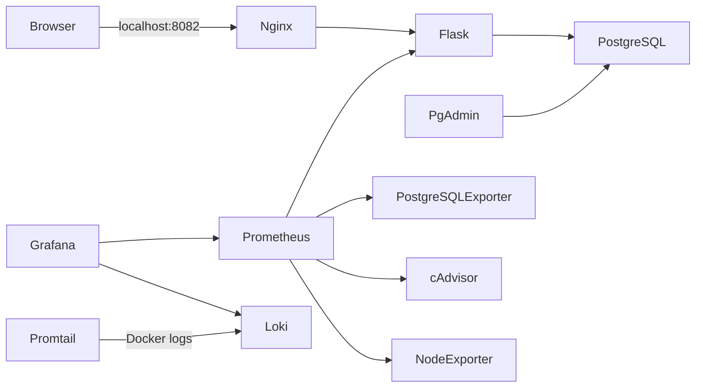

# ClinicCare — Quản lý phòng khám

Ứng dụng quản lý bệnh nhân, bác sĩ và lịch khám được triển khai bằng Flask,
PostgreSQL, Docker Compose và Nginx. Bộ giám sát gồm Prometheus, Grafana,
Loki, Promtail, cAdvisor, Node Exporter và PostgreSQL Exporter.

> Mật khẩu và khóa bí mật chỉ được lưu trong `.env` tại máy chạy dự án.
> Không đưa `.env` vào Git, ảnh chụp báo cáo hoặc nội dung gửi công khai.

## Kiến trúc



- `frontend` nối Nginx với Flask; `backend` nối Flask, PostgreSQL, pgAdmin,
  PostgreSQL Exporter và Prometheus. PostgreSQL không publish cổng ra host.
- `monitoring` nối Prometheus, Grafana, Loki, Promtail và exporters.
- `host_access` là network bridge cho các giao diện cần publish; các cổng chỉ
  bind vào `127.0.0.1`. Network này cho phép outbound qua Docker bridge.
- PostgreSQL, pgAdmin, Prometheus, Grafana và Loki dùng named volumes để giữ
  dữ liệu khi container được thay mới. Không dùng `docker compose down -v`.
- Flask chạy bằng Gunicorn với user không đặc quyền. Nginx thêm các security
  headers cho website.

## Cây thư mục

```text
clinic-management/
├── .env.example
├── .gitattributes
├── .gitignore
├── docker-compose.yml
├── README.md
├── BAO-CAO-TRIEN-KHAI.md
├── app/
│   ├── app.py
│   ├── database.py
│   ├── Dockerfile
│   ├── requirements.txt
│   └── templates/
│       ├── appointments.html
│       ├── base.html
│       ├── doctors.html
│       └── patients.html
├── database/
│   ├── init.sql
│   └── 02-create-runtime-roles.sql
├── nginx/
│   └── nginx.conf
└── monitoring/
    ├── alerts.yml
    ├── loki-config.yml
    ├── prometheus.yml
    ├── promtail-config.yml
    └── grafana/
        ├── dashboards/clinic-management.json
        └── provisioning/
            ├── dashboards/dashboards.yml
            └── datasources/datasources.yml
```

## Dịch vụ và địa chỉ

| Dịch vụ | Địa chỉ từ máy chủ | Vai trò |
| --- | --- | --- |
| ClinicCare qua Nginx | <http://localhost:8082> | Website bệnh nhân, bác sĩ, lịch khám |
| pgAdmin | <http://localhost:5050> | Giao diện quản trị PostgreSQL |
| Prometheus | <http://localhost:9090> | Metrics, scrape targets và cảnh báo |
| Grafana | <http://localhost:3000> | Dashboard và truy vấn metrics/logs |
| Loki API | <http://localhost:3100/ready> | API lưu trữ log |
| Flask trực tiếp | Không publish | Chỉ truy cập nội bộ qua Nginx/Prometheus |
| PostgreSQL | Không publish | Chỉ truy cập qua network `backend` |
| Exporters | Không publish | Chỉ Prometheus truy cập trên network nội bộ |

Các cổng host chỉ bind vào loopback (`127.0.0.1`), không chủ ý mở ra mạng LAN.

### Thông tin đăng nhập

- pgAdmin: dùng `PGADMIN_DEFAULT_EMAIL` và `PGADMIN_DEFAULT_PASSWORD` trong
  `.env`. Khi đăng ký máy chủ PostgreSQL trong pgAdmin, nhập host `db`, port
  `5432`, database `POSTGRES_DB`. Tài khoản `APP_DB_USER` có quyền CRUD trong
  schema `public`; `POSTGRES_USER` có quyền quản trị cao hơn. Dùng app role cho
  kết nối xem dữ liệu thông thường.
- Grafana: dùng `GRAFANA_ADMIN_USER` và `GRAFANA_ADMIN_PASSWORD` trong `.env`.
- Không ghi lại giá trị mật khẩu trong báo cáo. Nếu cần ảnh đăng nhập, che các
  trường thông tin xác thực.

## Cài đặt và khởi động

1. Cài Docker Desktop và bật Linux containers.
2. Tạo `.env` từ mẫu (nếu chưa có):

   ```powershell
   Copy-Item .env.example .env
   ```

3. Thay các giá trị mẫu trong `.env` bằng email hợp lệ và mật khẩu/secret ngẫu
   nhiên mạnh. Giữ nguyên `.env` cục bộ; không commit file này.
4. Kiểm tra cấu hình và khởi động:

   ```powershell
   docker compose config --quiet
   docker compose up -d --build
   docker compose ps
   ```

5. Chờ healthcheck của PostgreSQL và ứng dụng chuyển sang `healthy`, sau đó
   truy cập các địa chỉ trong bảng trên.

Compose sẽ tạo/recreate các container khi cấu hình thay đổi; named volumes
không bị xóa bởi `up -d --build`. File `database/init.sql` chỉ được PostgreSQL
chạy khi khởi tạo data directory lần đầu, không phải cơ chế migration cho
database đã tồn tại. Ứng dụng sử dụng role `APP_DB_USER` có quyền CRUD, còn
PostgreSQL Exporter dùng role riêng chỉ được cấp `pg_monitor`. Khi database
đã tồn tại, cập nhật role cần được áp dụng tường minh bằng
`database/02-create-runtime-roles.sql`; không xóa volume.

## Xác minh

### Website, database và headers

```powershell
Invoke-WebRequest http://localhost:8082/health
Invoke-WebRequest -Method Head http://localhost:8082/
docker compose ps
docker compose logs --tail 100 app db nginx pgadmin
```

`/health` trả HTTP 200 khi Flask truy vấn được PostgreSQL; lỗi kết nối trả
HTTP 503. Nginx cần trả các header `X-Content-Type-Options`,
`X-Frame-Options` và `Referrer-Policy`.

### Prometheus

Mở <http://localhost:9090/targets> và kiểm tra các job `prometheus`,
`clinic-app`, `postgresql`, `cadvisor` và `node-exporter` có trạng thái `UP`.
Có thể kiểm tra API:

```powershell
Invoke-RestMethod http://localhost:9090/api/v1/targets
Invoke-WebRequest http://localhost:9090/-/healthy
```

### Grafana

Datasource Prometheus và Loki được provision tự động. Dashboard **ClinicCare -
Overview** được provision trong folder **ClinicCare**. Nếu dashboard trống,
kiểm tra trạng thái targets, thời gian chờ thu thập dữ liệu và log Grafana.

### Loki và LogQL

Promtail phát hiện container qua Docker socket; label `container` được lấy từ
tên container thực tế (Compose project `clinic-management`) và label `service`
được lấy từ nhãn Compose. Trong Grafana Explore, chọn datasource Loki và chạy:

```logql
{container="clinic-management-app-1"}
{container="clinic-management-nginx-1"} |= "error"
{container="clinic-management-db-1"} |~ "(?i)error"
```

Các biểu thức trên đã được gọi qua Loki API trong lần kiểm tra hiện tại; xem
kết quả thực tế ở bảng bằng chứng. Promtail được giới hạn vào Compose project
`clinic-management`, không đọc log của project khác.

```powershell
Invoke-WebRequest http://localhost:3100/ready
Invoke-RestMethod http://localhost:3100/loki/api/v1/labels
docker compose logs --tail 100 loki promtail
```

### Tình trạng bằng chứng đã chạy

| Kiểm tra | Kết quả thực tế |
| --- | --- |
| Compose config cuối cùng | `docker compose config --quiet`: hợp lệ |
| Stack | `docker compose up -d --build`: hoàn tất |
| Website `/health`, `/patients`, `/doctors`, `/appointments` | HTTP 200; health báo database connected |
| pgAdmin từ host | `/` và `/misc/ping`: HTTP 200; trang đăng nhập hiển thị |
| Prometheus | `/-/healthy`: HTTP 200; API kiểm tra 5/5 targets `UP` |
| PostgreSQL exporter | `pg_up=1`; app/exporter role không phải superuser, exporter có `pg_monitor` |
| Node Exporter | Target `UP`; 64 series CPU và 1 series RAM |
| Grafana | `/api/health`: HTTP 200; datasource Loki/Prometheus và dashboard tìm thấy qua API; UI chưa xác minh |
| Loki | `/ready`: HTTP 200 (`ready`) |
| `{container="clinic-management-app-1"}` | Loki API `status=success`, 1 stream trong cửa sổ kiểm tra |
| `{container="clinic-management-nginx-1"} |= "error"` | Loki API `status=success`, 0 stream trong cửa sổ kiểm tra |
| `{container="clinic-management-db-1"} \|~ "(?i)error"` | Loki API `status=success`, 0 stream trong cửa sổ kiểm tra |
| Nginx headers | `nosniff`, `DENY`, `strict-origin-when-cross-origin` và CSP đã nhận |
| HTTPS | Chưa cấu hình; môi trường hiện không có OpenSSL để tạo cert PEM cục bộ |

## Log, xử lý sự cố và dừng dịch vụ

```powershell
docker compose ps
docker compose logs --tail 100
docker compose logs -f app nginx db pgadmin prometheus grafana loki promtail
docker compose restart pgadmin
docker compose stop
docker compose up -d
```

- Không vào được pgAdmin: kiểm tra `PGADMIN_DEFAULT_EMAIL` có cú pháp email
  hợp lệ, `PGADMIN_DEFAULT_PASSWORD` không rỗng, xác nhận cổng host 5050 không
  bị chiếm; sau đó chạy `docker compose up -d --force-recreate pgadmin`.
- Đăng nhập pgAdmin không được sau khi đổi `.env`: pgAdmin có thể giữ cấu hình
  khởi tạo trong volume. Không xóa volume; kiểm tra log và xử lý thay đổi thông
  tin xác thực theo thủ tục quản trị pgAdmin.
- App không healthy: xem `docker compose logs app db`; kiểm tra
  `DATABASE_URL` được tạo từ các biến PostgreSQL và `docker compose ps`.
- Nếu ứng dụng đã chạy trước khi role runtime được thêm, áp dụng
  `database/02-create-runtime-roles.sql` trước khi recreate app.
  Có thể áp dụng bằng PowerShell sau khi xác nhận `.env` có hai biến này. Lệnh
  không in hoặc đưa mật khẩu lên dòng lệnh:

  ```powershell
  $envValues = @{}
  Get-Content .env | ForEach-Object {
      if ($_ -match '^([^#=]+)=(.*)$') { $envValues[$matches[1]] = $matches[2] }
  }
  $dbUser = $envValues['POSTGRES_USER']
  $dbName = $envValues['POSTGRES_DB']
  if ([string]::IsNullOrWhiteSpace($dbUser) -or [string]::IsNullOrWhiteSpace($dbName)) {
      throw 'POSTGRES_USER hoặc POSTGRES_DB chưa được cấu hình trong .env'
  }
  docker compose exec -T db psql --set=ON_ERROR_STOP=1 --username $dbUser --dbname $dbName --file /docker-entrypoint-initdb.d/02-create-runtime-roles.sql
  ```

  Không chia sẻ đầu ra chứa thông tin xác thực và không xóa volume.
- Prometheus target `DOWN`: kiểm tra đúng target nội bộ và log của exporter.
- Loki không thấy log: kiểm tra `docker compose logs promtail loki`, quyền/khả
  năng truy cập Docker socket và label thực tế tại Grafana Explore.
- Nếu cổng đã bận, dừng tiến trình/dịch vụ chiếm cổng hoặc đổi port mapping và
  cập nhật bảng địa chỉ trước khi chạy lại Compose.

Để dừng mà vẫn giữ dữ liệu, dùng `docker compose stop`. `docker compose down`
(không có `-v`) cũng giữ named volumes; không sử dụng `docker compose down -v`.

## Hardening và giới hạn đã biết

- `.env` bị loại khỏi Git bởi `.gitignore`; `.env.example` chỉ có placeholders.
- PostgreSQL không publish cổng host. Dịch vụ chỉ giao tiếp qua network nội bộ.
- Flask dùng role không-superuser chỉ có quyền CRUD; PostgreSQL Exporter dùng
  role riêng có quyền `pg_monitor`.
- Flask chạy non-root; filesystem container chỉ đọc và `/tmp` là tmpfs ghi được.
- Prometheus/Grafana/pgAdmin/Nginx/Loki chỉ publish trên loopback.
- Nginx bật `X-Content-Type-Options`, `X-Frame-Options`,
  `Referrer-Policy` và CSP; HTTP không bật HSTS vì chưa triển khai HTTPS.
- Promtail cần Docker socket để phát hiện container. Socket cấp quyền điều khiển
  Docker daemon ở mức cao; Promtail chạy root để đọc log và discovery bị giới
  hạn vào project này. Chỉ chạy trên máy tin cậy, không mở Docker API ra mạng.
- cAdvisor cần đọc thông tin host/container; Node Exporter trên Docker Desktop
  phản ánh Linux VM thay vì toàn bộ Windows host. cAdvisor ghi nhận thiếu
  `/sys/class/dmi/id/product_name`, nhưng target vẫn `UP`.
- Promtail đã hết vòng đời hỗ trợ upstream. Ở đây dùng theo yêu cầu bài tập;
  với triển khai mới cho production nên chuyển sang Grafana Alloy.
- Chưa có HTTPS tự ký trong cấu hình này. Trên môi trường hiện tại không tìm
  thấy OpenSSL để tạo chứng thư Nginx; trình duyệt cũng sẽ cảnh báo nếu chứng
  thư tự ký chưa được trust. Không bật TLS với chứng thư không được kiểm chứng.
- Ở lần chạy Promtail đầu tiên, discovery chưa lọc Compose project và Loki đã
  nhận thử log từ project khác, đồng thời từ chối một số dòng quá cũ (HTTP 400).
  Đã thêm bộ lọc project; không xóa volume Loki, nên log đã lưu có thể còn đến
  khi retention 7 ngày tự hết hạn.
- Trong lúc Compose thay container, Promtail cũng ghi một số lỗi chuyển tiếp
  khi Docker target cũ biến mất; target mới được phát hiện sau đó. Kiểm tra
  cuối không thấy log Promtail mới trong 90 giây.
- Workspace hiện không có `.git`; chưa thể tạo commit hoặc kiểm tra trạng thái
  Git. Các thông điệp commit bên dưới chỉ là gợi ý.

## Nội dung ba commit đã tạo

1. `feat: deploy Flask app, PostgreSQL, pgAdmin and Nginx` — ứng dụng, schema,
   network, healthcheck và proxy.
2. `feat: add Prometheus and Grafana monitoring` — exporters, scrape targets,
   cảnh báo CPU và dashboard.
3. `feat: add Loki log collection and harden services` — Loki/Promtail,
   datasource, `.gitignore`, biến môi trường mẫu và hardening.

## GitHub và lịch sử commit

Repository Git local đã được khởi tạo trên nhánh `main`, `.env` bị ignore.
Lịch sử gồm ba commit theo các mốc yêu cầu:

1. `feat: deploy clinic app, PostgreSQL, pgAdmin and Nginx`
2. `feat: add Prometheus and Grafana monitoring`
3. `feat: add Loki log collection and harden services`

**GitHub account/repository và remote chưa được tạo/cấu hình.** Chủ tài khoản
cần tự đăng ký trên GitHub bằng mã số sinh viên nếu tên còn khả dụng, sau đó
tạo repository (ví dụ `<MSSV>-clinic-management`) và kết nối bằng:

```powershell
git remote add origin https://github.com/<GITHUB_USERNAME>/<REPOSITORY>.git
git push -u origin main
```

Không dùng access token trong URL hoặc commit token/password. Không push
`.env`; kiểm tra bằng `git check-ignore .env` trước khi chia sẻ repository.

## Ảnh minh chứng cho báo cáo

Ảnh trong `evidence/` được chụp từ giao diện local ngày 18/10/2026. Ảnh đăng
nhập pgAdmin/Grafana chỉ chứng minh trang đăng nhập truy cập được; không chứng
minh đã đăng nhập hoặc đã kết nối database/dashboard:

| Ảnh | Minh chứng | Trạng thái |
| --- | --- | --- |
| `evidence/01-cliniccare-patients.png` | Website qua Nginx | Đã chụp |
| `evidence/02-prometheus-targets.png` | Giao diện Prometheus targets | Đã chụp; API xác nhận 5/5 UP |
| `evidence/03-pgadmin-login.png` | Trang login pgAdmin | Đã chụp; đăng nhập/server registration chưa xác minh |
| `evidence/04-grafana-login.png` | Trang login Grafana | Đã chụp; dashboard visual chưa xác minh |
| Grafana dashboard / Explore | Cần ảnh sau đăng nhập | Chưa chụp |
| `docker compose ps` / Nginx headers | Chụp terminal hoặc DevTools | Chưa chụp |

Không dựng hoặc chỉnh sửa ảnh để thể hiện kết quả chưa có. Trước khi nộp, chụp
pgAdmin sau khi đăng nhập và kết nối tới `db`, Grafana dashboard/Explore, cùng
Compose status và response headers; che dữ liệu cá nhân, email và credential.

Ghi thời gian, URL, lệnh và kết quả thực tế cạnh mỗi ảnh trong
`BAO-CAO-TRIEN-KHAI.md`.
